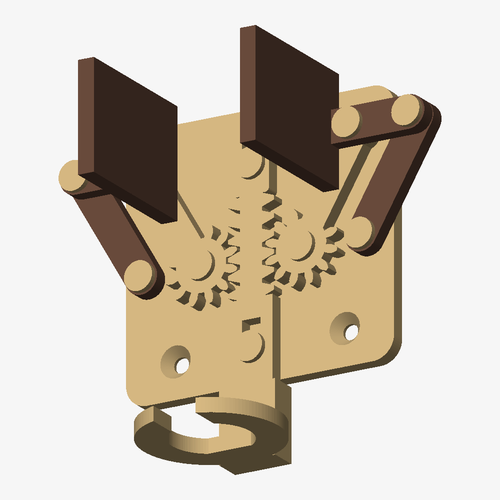
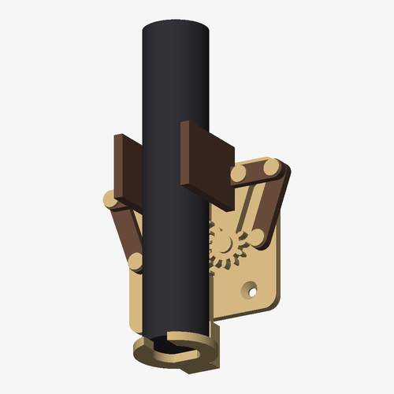
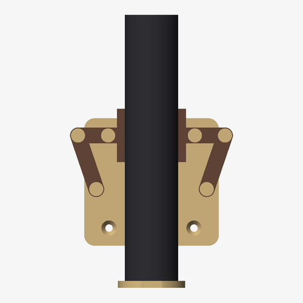

# حامل فرشاة أسنان كهربائية ذاتي القفل

  

تضع الفرشاة على الحلقة السفلية، فينزل ثقلها المسنن (Slider) إلى الأسفل. المسنن يدير الترسين، والترسان يحرّكان الفكّين إلى الداخل فيمسكان الفرشاة. عندما ترفع الفرشاة، يرجع الفكّان ويفتحان من وزنهما.

الفكّان مركّبان على آلية متوازي أضلاع، لذلك تبقى الوسادات موازية للفرشاة دائماً. يفتح الفكّان حتى **41 مم** ويُغلقان حتى **9 مم**، فيناسب الحامل معظم الفراشي الكهربائية مثل Sonicare و Oral-B.

> الفكرة مستوحاة من تصميم ‎@MatthewGhost_3DPrint، لكن هذا تصميم مستقل مرسوم من الصفر.

## القطع

| الملف | العدد | ملاحظة |
|---|---|---|
| `stl/base.stl` | 1 | اللوح الخلفي على الحائط |
| `stl/slider.stl` | 1 | المسنن المستقيم (الجزء المنزلق) |
| `stl/cradle.stl` | 1 | الحلقة التي تقف عليها الفرشاة |
| `stl/gear_arm.stl` | **2** | ترس مع ذراع |
| `stl/link.stl` | **2** | ذراع موازية |
| `stl/jaw_left.stl` و `stl/jaw_right.stl` | 1 + 1 | الفكّان |
| `stl/pins.stl` | 12 | مسامير مطبوعة؛ يلزم 10 منها، و2 احتياط |

## الطباعة (Bambu Studio)

- الخيط PLA أو PETG، و Process **0.20mm Standard**، و Wall loops = 3، و Infill بنسبة 20%. لا تحتاج أي قطعة إلى Supports.
- كل القطع جاهزة بالاتجاه الصحيح. اترك الحلقة `cradle` على وجهها المسطّح.
- **المسامير** `pins.stl` جاهزة وهي مستلقية على جنبها، وهذا يجعلها أقوى. لا تغيّر اتجاهها.
- للحصول على شكل مثل الفيديو: الفكّان والذراعان الموازيتان بني، وباقي القطع بيج.
- كل القطع تتسع على Plate واحد في X1 و P1 و A1، أو على Plate واحد أو اثنين في A1 mini.

## التركيب

1. أدخل كل مسمار من الأعلى. المسمار يدخل بإحكام في القطعة السفلية، ويبقى حراً في القطعة التي فوقها. إذا كان المسمار مرتخياً، ضع نقطة غراء فوري (CA) في الثقب السفلي فقط.
2. ضع **الـ Slider** على اللوح بحيث تكون أسنانه في المنتصف، وثبّته بمسمارين في ثقبيه الطوليين.
3. ركّب **الترس مع الذراع** على كل جهة. ارفع الـ Slider إلى أعلى ما يمكن، وثبّت الترس على اللوح والذراع مائلة للخارج، حتى تتعشّق الأسنان.
4. ركّب **الذراعين الموازيتين** في الثقبين الخارجيين من اللوح.
5. ركّب **الفكّين** فوق أطراف الأذرع، بحيث تتجه الوسادات للأمام وللداخل.
6. ألصق **الحلقة** على طرف الـ Slider السفلي بنقطة غراء.
7. ثبّت اللوح على الحائط بشريط لاصق مزدوج قوي (3M VHB) أو ببرغيين برأس مخروطي قطرهما 4 مم.
8. اختياري: ألصق شريط مانع للانزلاق (Grip tape) على الوجه الداخلي للوسادتين.

## التعديل

كل المقاسات موجودة كثوابت في أعلى `make_holder.py`، مثل طول الذراع وزوايا الفتح والإغلاق وارتفاع الوسادة وبُعد الفرشاة عن الحائط.

```bash
pip install manifold3d trimesh shapely numpy scipy networkx
python3 make_holder.py
```

بعد توليد الملفات، يفحص السكربت أن الآلية تتحرك بدون أي تصادم بين القطع في كل الوضعيات، من الفتح الكامل إلى الإغلاق الكامل.
