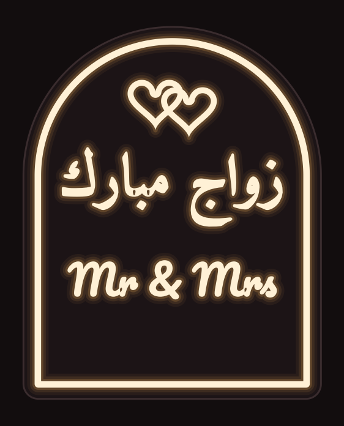
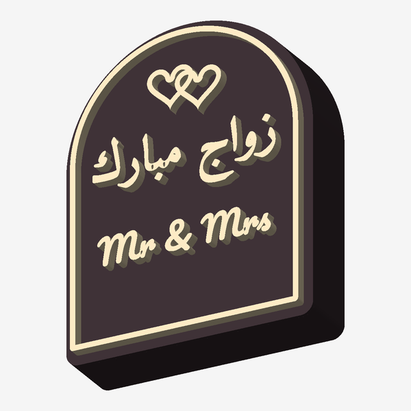

# لوحة زفاف مضيئة بحروف بارزة — Wedding LED Sign

 

لوحة على شكل قوس، **160 × 200 × 45 مم** تقريباً بعد التركيب. تتكون من قطعتين تُطبعان بدون دعامات:

| الملف | القطعة | اللون المقترح |
|---|---|---|
| `stl/sign_box.stl` | الصندوق الخلفي، فيه الإضاءة | لون معتم (أسود، ذهبي، وردي) |
| `stl/sign_front.stl` | الواجهة بحروف بارزة ومجوّفة | أبيض شفاف للحروف، ولون معتم للخلفية |

الحروف مجوّفة من الخلف (Channel Letters). ضوء الـ LED يدخل من داخل الصندوق إلى كل حرف، فيضيء وجه الحرف (0.8 مم) وجوانبه، بينما تبقى الخلفية معتمة.

## إعدادات الطباعة

- **الواجهة** `sign_front.stl` تُطبع ووجهها على السرير، والملف مُعدّ بهذا الاتجاه ومعكوس مسبقاً.
  - من 0 إلى **7.0 مم**: خيط **PLA/PETG أبيض شفاف (Natural)**.
  - عند **7.0 مم** غيّر الخيط إلى اللون المعتم. في Cura استخدم *Pause at height*، وفي PrusaSlicer/Bambu أضف *Color change* عند هذه الطبقة.
  - ارتفاع الطبقة 0.2 مم، وطبقتان للجدران، و Infill بنسبة 100%. الأجزاء رفيعة أصلاً، فالـ Infill لن يؤثر عليها كثيراً.
- **الصندوق** `sign_box.stl` يُطبع وظهره على السرير وفتحته للأعلى. يكفي Infill بنسبة 15%.
- المقاسان يناسبان سريراً بحجم 220 × 220 مم مثل Ender 3 و Bambu A1 و Prusa MK4.

## الإضاءة والتركيب

1. ألصق شريط LED أبيض دافئ (USB 5V، تقريباً 50–80 سم) على السطح الداخلي لظهر الصندوق بشكل حلزوني أو متعرّج.
2. أخرج السلك من الفتحة السفلية في الظهر (قطرها 9 مم).
3. ركّب الواجهة على الصندوق، فالحافة الخلفية للواجهة تدخل داخل الصندوق بإحكام. ثبّتها بنقاط غراء إذا لزم.
4. في الظهر فتحتا تعليق (Keyhole) إذا أردت تعليق اللوحة على الحائط، أو أوقفها على الطاولة مباشرة لأن قاعدتها مسطحة.

## تخصيص النص (الأسماء والتاريخ)

```bash
pip install trimesh manifold3d shapely scipy networkx "matplotlib>=3.11"
python3 make_wedding_models.py --arabic "زواج مبارك" --names "Ahmad & Sara" --date "16.10.2026"
```

يعيد الأمر توليد ملفات STL وصورة المعاينة. يمكن تغيير المقاسات (عرض اللوحة وعمقها وبروز الحروف) من الثوابت في أعلى السكربت.

الخطوط المستخدمة: Amiri Bold للعربي و Pacifico للاتيني، وكلاهما برخصة SIL Open Font License.
